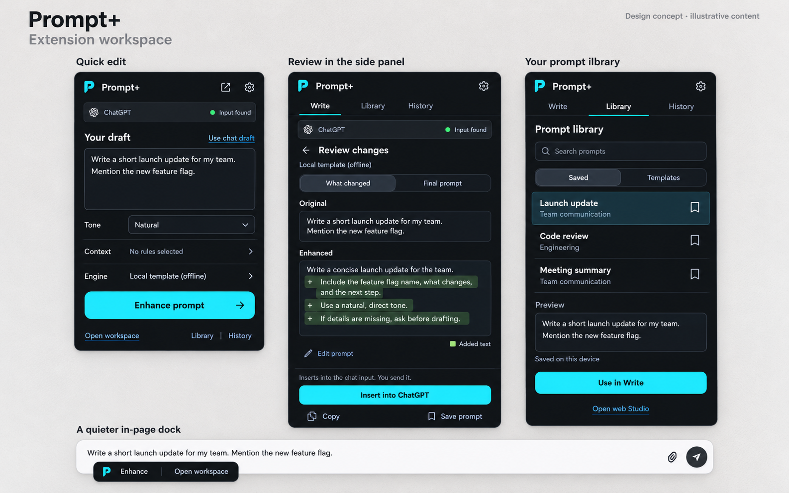

# Prompt+ extension workspace redesign

Design proposal prepared on 2026-10-19 against checkout `ef8f49a`. This deliverable contains a plan and an illustrative concept image; it does not implement the redesign.

**Recommendation:** make the popup a quick editor, the side panel the complete workspace, and the in-page dock a small entry point. Organize the workspace around **Write, Library, and History**. Keep context beside the draft and settings behind a header button.



The image was generated with the built-in imagegen tool. Its prompt text, saved items, and connection states are illustrative. The image establishes direction; the behavioral requirements below are authoritative. Generation prompt: [extension-workspace-image-prompt.txt](design/extension-workspace-image-prompt.txt).

**What the current extension already does well**

Preserve the existing word diff, explicit review before insertion, guarded undo, offline synthesis, source labels, keyboard support, and shared cyan brand tokens. This proposal extends that foundation. The earlier [extension UI/UX plan](EXTENSION-UIUX-PLAN.md) records shipped work and remains a historical reference.

Current findings come from source inspection and the repository's existing screenshots, not a new live usability study:

| Current structure | Consequence | Proposed change |
| --- | --- | --- |
| `popup.html` has Enhance, Library, Context, Settings, quick links, and a More options drawer inside a fixed 410 × 560 surface. | Writing competes with navigation; engine choice is buried with unrelated tools. | Keep draft, tone, context, engine, and Enhance visible; move management into the workspace. |
| `sidepanel.html` and `sidepanel.js` provide an editor and result comparison, with less capability than the popup. | Opening the larger surface loses access to some tools. | Make the panel the complete workspace using the same editor and review logic. |
| `sidepanel.js:restoreDraft()` prefers `pp_panel_draft` over `pp_popup_draft`; the schemas differ. | An existing panel draft can supersede the draft the user just handed over. | Use shared, revisioned draft state and explicit handoff identity. |
| `popup.js` initializes several development/security context rules as active. | A general writing task can receive unrelated instructions. | Start fresh installs with no context selected; preserve existing user choices during migration. |
| `content.js:injectEnhanced` opens another review after popup/panel review. | Insertion can repeat the same decision in a second surface. | Review once, then insert through a target and revision check. |
| Popup Library mixes templates, saved work, and a history timeline. | Finding a reusable prompt and recovering a recent attempt share an unclear destination. | Library holds deliberately saved prompts and templates; History holds recent attempts. |

**New information structure**

| Surface | Structure | Main action |
| --- | --- | --- |
| Toolbar popup | Header → detected destination → draft → tone/context/engine → action → workspace links | Enhance prompt, then review and insert/copy |
| Side panel: Write | Write / Library / History navigation → destination → draft controls → editor → review state | Enhance prompt, then Insert into [site] |
| Side panel: Library | Search → Saved / Templates filter → list → selected preview | Use in Write |
| Side panel: History | Recent attempts → original/result details → restore | Restore as draft |
| Context editor | Inline disclosure from Write; select rules and preview their exact text | Apply to this draft |
| Settings | Header gear → engine setup, account/sync, appearance, shortcuts, data controls, diagnostics | Save the relevant setting |
| In-page dock | Enhance + Open workspace; extra actions in a small menu | Enhance the current chat draft |

Keep **Open web Studio** as a secondary handoff. Put the existing platform launcher in the reviewed result's **Open in…** menu. Keep **Open in all** secondary and identify its destinations. Move connection latency/version/diagnostics into Settings. Expose conversation token estimates through a labeled **Chat usage** disclosure near the destination; show “Visible messages only” and “Capacity unknown” when appropriate.

**Writing and reviewing**

- **Start:** show the detected site and editor status separately from cloud connection status. “Input found” means an adapter found the composer. “Cloud unavailable” must not imply that local enhancement is broken.
- **Import:** offer “Use chat draft.” Import automatically only into an empty, unsaved draft. Never replace existing work silently.
- **Configure:** keep tone and engine visible. Use “Local template (offline),” “Cloud model,” and, when supported, “On-device model.” Show cloud setup requirements before a request. Reveal context rule text before enabling it; allow saving a default explicitly.
- **Generate:** keep the original editable and provide Cancel. Show the active engine, not a fake percentage. If upstream cancellation is unavailable, stop applying the response and explain that the cloud request may still finish.
- **Fallback:** explain a cloud failure and offer “Retry” and “Use local template.” If retaining automatic fallback, disclose the fallback prominently on the result. The selected engine and actual result source are separate fields.
- **Review:** open “What changed” when a real difference exists; otherwise show “No changes” and the final prompt. Reuse `lib/diff.js`. Stack Original and Enhanced at narrow widths. Allow editing the final prompt and recompute the comparison. Preserve the engine source and add “Edited locally” after manual editing.
- **Insert:** label the action “Insert into ChatGPT,” or the detected destination. Explain “Inserts into the chat input. You send it.” Capture the target and its draft when the operation starts; validate again immediately before inserting. Show success only after acknowledgement/readback.
- **Recover:** offer Undo after insertion, guarded against subsequent chat edits. If the chat changed, keep the result and offer “Review latest draft” or “Copy.” Never overwrite newer typing or submit the host chat automatically.

The popup supports the same short edit/review flow. Opening the workspace carries the exact draft, context, tone, engine, result, and review state. Users should not need to re-enter anything.

**Library and History**

Use readable rows separated by rules instead of a grid of small cards. Each saved prompt has a title, preview, and actual storage location: “On this device” or a confirmed account sync state. Previewing a prompt must not overwrite the current draft; “Use in Write” creates/restores a draft deliberately. Existing cloud records and templates remain accessible.

Add explicit local saving so signed-out users can save a prompt. Treat cloud sync as a separate state: pending, synced, or failed. Preserve unsynced content on errors. Keep the current history retention limit initially; expose deletion and clearing controls with recovery where feasible.

History records should contain the full original, result, source, settings, and an absolute creation time for new entries. Existing history stores a truncated original and a time-only label: migrate it honestly, mark incomplete original text, and do not invent dates or complete comparisons. Empty states say “No saved prompts yet” and “Your enhanced prompts will appear here.” Example content belongs only in the labeled concept image or Templates.

**Visual direction**

Use Cabinet Grotesk, selected through the gpt-taste seed, with a system sans-serif fallback. Bundle the licensed font locally after verifying redistribution terms. Keep the existing cyan identity, use open spacing and clear hierarchy, and reserve colored surfaces for actions, selection, and diff meaning.

| Token or component | Proposed specification |
| --- | --- |
| Background / elevated surface | `#101216` / `#191D23` |
| Main / secondary text | `#F5F7FA` / `#B4BDC9` |
| Primary button | `#22D3EE` with `#081216` text |
| Typography | Body 14px; supporting text 12–13px; headings 20–24px; comfortable line height |
| Layout | Retain a 410px popup baseline; validate within its existing 560px height. Side panel adapts to available width; use 320–600px as test widths, not assumed browser limits. |
| Spacing | 4px base scale, 16px outer inset, 12–16px field separation |
| Controls | Aim for 40–44px height; visible focus; generous clickable area for icons |
| Surfaces | Modest 10–14px corners; thin separators; limited shadow; one clear primary action per state |
| Overflow | Stable header, one content scroller, action footer that remains reachable at zoom; no horizontal clipping |
| Motion | Short state transitions around 120–180ms; no movement while reading or typing; reduced-motion support |

Calculated during this planning pass: main text on background is **17.47:1**, secondary text on elevated surface is **8.91:1**, and primary-button text is **10.48:1**. These pairs meet the normal-text threshold; all interactive, disabled, diff, focus, and hover states still require rendered validation. See [WCAG text contrast](https://www.w3.org/WAI/WCAG22/Understanding/contrast-minimum.html) and [target size guidance](https://www.w3.org/WAI/WCAG22/Understanding/target-size-minimum.html).

The concept uses a shorter illustrative enhanced prompt. Implementations must display real engine output; this UI plan does not authorize substituting the sample text or claiming an improvement score. All telemetry must come from stored or computed values, with approximation and provenance labels where applicable.

**Applying gpt-taste to an extension**

The skill's deterministic selection was run using the 91-character task sentence as the seed:

```text
seed=91 | hero=Cinematic Center | font=Cabinet Grotesk
components=Horizontal Accordions, Feedback/Testimonial Carousel, Infinite Marquee
motion=Card Stacking, Image Scale & Fade Scroll
```

Use the selected typography and centered presentation hierarchy in the concept board. The landing-page components are unsuitable for this editing task: testimonials, marquees, scroll pinning, cinematic section padding, and scrolling card stacks would consume the extension's limited working space. They are not proposed product features. No React/UI code is being written in this planning task.

Adapt AIDA into the utility flow: destination and draft establish attention; tone/context clarify possibilities; the real comparison demonstrates the change; Insert/Copy completes the task. Use short headings, legible buttons, restrained ornament, and consistent spacing. No hero, bento layout, stock photography, or GSAP dependency is needed for this extension proposal. A separate presentation webpage, if requested later, can apply the skill's full pre-flight and motion requirements.

**Implementation structure**

Keep the extension's existing plain JavaScript architecture. Extract shared behavior before changing the surfaces. Retain the current synthesis, diff, tokenizer, adapters, and web bridge.

| Location | Responsibility |
| --- | --- |
| `extension/design-tokens.css` | Shared typography, spacing, surfaces, focus, and motion tokens; preserve compatibility with the web app that imports it |
| Proposed `extension/lib/workspace-state.js` | Versioned draft/result schema, migration, handoff, and revision checks |
| Proposed `extension/lib/workspace-controller.js` | Enhance/cancel/review state transitions, engine/tone/context selection, source labels |
| Proposed `extension/lib/review-view.js` | Shared accessible review rendering around the existing diff utility |
| Proposed `extension/lib/workspace.css` | Popup/panel primitives and responsive rules |
| `extension/popup.html`, `popup.js` | Compact quick edit and shared review; workspace destination links |
| `extension/sidepanel.html`, `sidepanel.js` | Full Write, Library, History, and Settings views |
| `extension/content.js` | Small dock, target capture, insertion/readback/undo; in-page review fallback |
| `extension/background.js` | Route workspace requests, serialize shared storage mutations, manage request identities |
| `scripts/package-extension.mjs` | Include new shared assets and font files; validate all referenced assets in the archive |

Use a draft identity, schema version, revision, updated time, input, tone, context, engine, and a result tied to its input revision. Include result provenance and a transient target identity. Share the active draft within its window; isolate drafts belonging to different chats. Revalidate tab/frame/conversation/editor identity after navigation or restart rather than trusting persisted targets.

Have the worker arbitrate writes with revision checks. Hydrate state before enabling autosave. Reject stale updates instead of using unconditional last-write-wins. Preserve both legacy popup and panel drafts when their order cannot be established; the old records have no reliable update timestamps. An explicit current handoff takes priority for that operation. Retain recoverable legacy data until migration completes.

Closing a popup must not lose a pending request or its eventual result. Persist request identity and completed results; if a worker restart interrupts processing, restore the draft with an interrupted state rather than inventing completion. Cancelled or stale results cannot become insertable.

Only the surface showing the review owns acceptance. A reviewed insert request carries the result revision and expected target text; the content script validates before mutation. Legacy/context-menu entry points still use the existing in-page review. This removes duplicate review without weakening stale-edit protection.

Open the side panel directly from a user gesture and feature-detect support. Trigger opening without awaiting unrelated work; hydrate the draft once the panel is ready. Keep a usable popup/in-page fallback if opening fails. These constraints follow the [Chrome Side Panel API](https://developer.chrome.com/docs/extensions/reference/api/sidePanel).

**Delivery sequence**

| Phase | Deliverable | Completion condition |
| --- | --- | --- |
| Foundation | Shared draft/result state, migration, review controller, design tokens | Fresh popup drafts reach the panel; old drafts remain recoverable; stale writes and late results cannot win |
| Workspace | Write / Library / History, contextual rules, settings, visible engine control | All current tools have a clear destination; opening the workspace preserves the active task |
| Quick surfaces | Compact popup, quieter dock, one guarded review-to-insert path | The user can enhance, review, insert, and undo without repeated review or hidden submission |
| Polish and release validation | Typography, motion, focus, empty/error states, package assets | Responsive/accessibility checks and extension regression tests pass; live adapter smoke checks completed |

Start with the shared state foundation. Styling before handoff and target semantics would preserve the current inconsistencies beneath a new appearance.

**Acceptance scenarios**

- Type in the popup, open the panel with an older panel draft present, and recover the exact intended draft and settings.
- Edit in both surfaces; stale storage events cannot erase newer input. Reload and migration do not silently choose or discard an ambiguous draft.
- Start enhancement, edit the input or cancel, then resolve the request. The response cannot replace or approve the new draft.
- Review in the panel and insert once into the captured chat. Switch tabs, navigate, or edit the composer first: insertion stops and the result remains available to copy.
- Insert and Undo with textarea and contenteditable adapters. Typing after insertion prevents Undo from overwriting those edits. No test submits the host form.
- Use the extension signed out, offline, with a failed cloud request, an unavailable on-device model, and an unsupported page. Every state has a clear next action.
- Save locally and attempt cloud sync. Failures retain the prompt and identify the actual storage/sync state.
- Exercise keyboard-only navigation, tab semantics, Escape/back behavior, focus restoration, screen-reader announcements, reduced motion, narrow panels, long prompts, and 200% zoom.
- Empty library/history, incomplete legacy history, clipboard denial, storage failure, no editor, and failed side-panel opening have explicit states.
- All quality, token, capacity, latency, and sync claims have real sources. Unknown values stay unknown. UI examples never appear as live history.

Extend the existing extension tests for these behavioral risks: `src/__tests__/extension-state.test.ts`, `extension-review-diff.test.ts`, `extension-sync.test.ts`, and `e2e/extension/reliability.spec.ts`. Run `npm run test:extension`, `npm run test:extension:e2e`, and the honesty check after implementation. Validate an isolated package with `node scripts/package-extension.mjs --output-dir /tmp/prompt-plus-workspace-release`, then load that package for manual browser checks. Fixture tests cannot establish compatibility with every current live chatbot page.

**Planning validation:** inspected current popup/panel/content/storage/package paths, compared the saved screenshots, checked current official side-panel and accessibility guidance, inspected the generated concept, and calculated the proposed core contrast pairs. Runtime tests are deferred until implementation; no deployed or implemented UI improvement is claimed.
